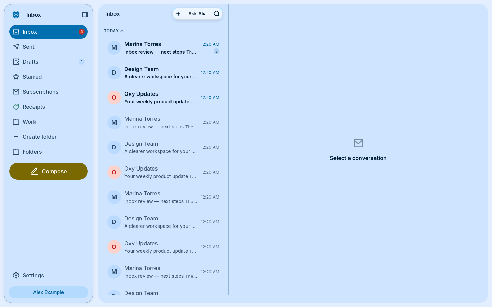
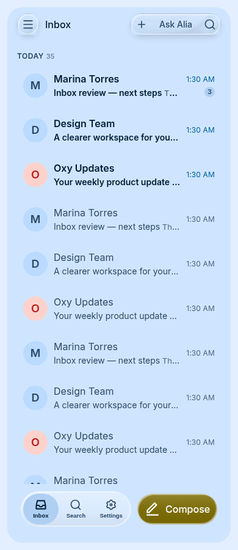

# Inbox UI migration to Bloom

Inbox uses one responsive Expo tree for web and Android. Mail is the primary
workspace; the brief and Alia open on demand.

The root `BloomScope size="md"` sets the shared component scale. The sidebar,
buttons and chips inherit it instead of declaring per-screen sizes. Change the root scope
to adjust the app's controls together. Lists use Bloom's single compact row
recipe. The obsolete density setting is ignored when reading saved preferences;
other account-scoped preferences are preserved.

Empty states use the same Oxy catalogue integration as Mention:
`@oxy.so/stickers` resolves the IDs in `lib/stickers.ts`, and Bloom's `Sticker`
renders the `EmptyState` illustration. Bloom owns playback, still-image fallback
and reduced motion. Every empty state includes a title and an explanation;
recovery states offer retry, and no-results states offer a way to clear the search.
Inline recovery rows use compact stickers. Settings collection sections pass
`emptyState` data directly to Bloom’s `SettingsProfilePage`.
The web renderer's WASM is bundled through the shared Metro preset; the CSP
allows WASM compilation without enabling JavaScript `unsafe-eval`.

## Component ownership

| Surface      | Shared Bloom primitives                                                   | Inbox responsibilities                                                                         |
| ------------ | ------------------------------------------------------------------------- | ---------------------------------------------------------------------------------------------- |
| Workspace    | AppShell, AppShellPanels, Sidebar, BottomBar, Fab                         | Mailbox/label destinations and SDK account actions                                             |
| Mail list    | ListItem, ListSelectionBar, VirtualList                                   | Virtualization, grouping, unreadable rows, bulk mutations and preferences                      |
| Conversation | PageHeader, PageFooter, MailThread, MailMessage                           | Safe HTML/CID resolution, unreadable entries, downloads, reply targets                         |
| Composer     | MailComposeSurface, MailRecipientField, TextFieldInput                    | Recipient validation/suggestions, editor, draft recovery, RFC reply headers and outbound queue |
| Settings     | SettingsModal and its page/row templates                                  | Existing preferences, forms, mutations and bookmarked route compatibility                      |
| Search       | Search, Dialog, Field, Select, DateRangePicker, Chip, EmptyState, Loading | Local operators, opt-in inference, saved/recent searches and pagination                        |

The custom drawer, tab bar, settings navigation, floating-header hook, row
density geometry and independent color palette are removed. Structured mail
cards and the HTML editor remain domain-specific; neither is reimplemented by
this migration. Colors now come from semantic Bloom roles.

## Unified list adoption

`MessageRow` supplies mail data to `ListItem.mail`; it owns no row renderer or
spacing. The same row preserves snoozed times, draft recipients, delivery
labels, unread/starred/thread markers, preview preferences, labels, sentiment,
and file/card attachments. Inline body images stay out of the attachment rail.
Daily-brief rows use the same API. Bundles, reminders, subscriptions, unreadable
messages and template choices also use `ListItem`/`List`.

Avatar activation and touch long press enter the existing bulk-selection flow.
Selected rows toggle without opening the message, and selection disables swipe
and file actions. Desktop context actions and touch gestures belong to Bloom.
The app maps its saved left/right commands to `swipeActions` and explicit
`fullSwipeAction` keys; `none` exposes no action. Opening a swipe no longer
remounts the mail content. `ListSelectionBar` remains visible during selection,
including zero selected rows.

`VirtualList` retains each mailbox/search/subscription scroller, its restoration
key, stable IDs and pagination. Grouping does not turn a whole date bucket into
one mounted row. Existing account-guarded callbacks still own all mail writes;
this migration does not change legacy mutation persistence or transport.

Headers and controls use `Button` and `Button.Group`, with the former icon
preset's outline/neutral appearance specified directly. Mailbox and conversation
commands use `HeaderActions` to keep primary actions visible and move the rest
into overflow according to the header's own width. Folder and label pickers stay
mounted as persistent controls. Settings continue to use Bloom's settings pages
and grouped sections; existing setting descriptions remain untruncated.

## State and navigation

- `AppShell layout="collection-detail" presentation="framed"` owns the reveal
  drawer, fluid viewport, panel flow, bottom navigation and safe area. The list
  declares `role="collection"` and the reader `role="detail"`; their Screens
  declare collection and document content. Mailbox selection, route history and
  persisted user widths remain application state. Do not repeat the family's
  split mode, bounded flow, surface separation or default outer gutter in Inbox.
- Below Bloom's `md` breakpoint, the shell has no gutter and `ContentPanel`
  loses its frame. Navigation overlays a continuous, full-height surface;
  the lists use Bloom's measured `useBottomEdgeInset()` for trailing scroll
  clearance. No fixed bar height or safe-area arithmetic lives in Inbox.
- From `md`, the panels regain their gutter and rounding. Their
  `chrome="none"` keeps borders and panel shadows off the workspace, so the
  individual email cards remain the visible surfaces. `BloomScope` owns the
  shared panel/sidebar/message radius through `panelRadius` (28 by default).
  MailMessage and the reply Card (`radius="panel"`) inherit it too. They keep
  the panels' original circular corner geometry; changing the shared radius
  does not substitute a squircle.
- The framed family's separated presentation keeps the list and reader in
  separate panels with Bloom's resize handle between them.
- At Bloom's `lg` breakpoint (1024px), the compositor keeps the list
  beside the routed conversation/composer. Its shared divider is adjustable
  from 320–480px, initially 380px. Below `lg`, index routes render the list
  and conversation routes render the message in the same detail slot. The
  navigator stays mounted, preserving open drafts through a width change.
- Routes remain transparent and each pane owns its scrolling. The reader's
  `PageFooter` overlays reply actions with Bloom's bottom-edge gradient.
  The detail `ContentPanel appearance="plain"` inherits the shell surface without
  painting a backing card. Header and footer both use the semantic card color
  for the gradient; the surrounding reader remains transparent.
  Its scoped inset keeps the last message and inline reply reachable, without
  contributing another claim to the navigation bar's edge registry.
- `MailMessage` keeps the same card surface when expanded or collapsed;
  `MailThread` spaces messages with its shared gap. Inline replies compose the
  same Bloom `Card` with the frameless `MailComposeSurface`. The thread title
  uses spacing without an extra divider. Inbox places the conversation count
  above its Bloom `display-4-medium` heading, with a 672px maximum width and
  24px spacing before the message stack.
- Opening a readable thread automatically requests its AI summary through the
  existing Oxy inference route, including single-message threads. Fresh results
  are reused from the query cache on reopening. The summary renders nothing
  on error or an empty response; no placeholder card or empty wrapper remains.
- The compositor isolates render failures in each pane. Inbox supplies only
  its sticker and translated `emptyState` data; Bloom owns the fallback layout,
  scroll clearance and retry. Route changes reset failed boundaries without
  remounting healthy panes. The outer provider-free boundary remains the last
  line of defense if a root provider itself fails.
- Bloom `ScrollMetricsProvider` connects `ScrollArea`, PageHeader and PageFooter.
  Both use `scrim="auto"` and inherit the containing Screen surface: the header
  fades out at the start, the footer at the end, and both disappear when the
  content fits. Inbox does not override their shared background color. Resizing
  and expanding quoted content update the shared measurements without application
  scroll handlers.
- On web, Bloom 22.1.3 defers virtual-row measurements while a pane is hidden or its
  geometry is transitioning, then measures the settled rows. Returning from a
  compact reader therefore preserves the mailbox's restored scroll position;
  ordinary content changes still update row heights and scroll anchoring.
  The shared bottom bar measures Compose intrinsically after becoming visible,
  and `MailMessage` fits reply actions to its usable body width. Inbox supplies
  no measurement filters, transition timers or responsive width corrections.
- Message citations use Bloom `MailMessage.trimmed` / `MailQuoteToggle`. Inbox
  identifies mail-client quote containers with a platform-neutral HTML parser,
  preserving surrounding styles and visible inline answers. Plain-text
  attributions are also folded. Both fragments retain the existing HtmlBody
  sanitization, resource proxy and sandbox. Unrecognized content stays visible.
- Search uses Bloom's responsive filter dialog, selectors, calendar and chips.
  Committed filter state persists above responsive pane mounts. Cancel discards
  the dialog draft; applying a filter turns parsed operators into editable chips,
  so removing a chip removes the actual request filter. Saved searches retain
  dates, labels and `unread: false`. Calendar ranges include the entire last local
  day, matching the API's inclusive timestamps. Filters and saved searches scroll
  with the results so they cannot consume the whole height of a small viewport.
- Inbox's locale scope also scopes Bloom's fixed strings and date controls.
- Subscriptions uses one solid workspace surface, like the mailbox list. The
  routed navigator stays in the same slot so switching to this full-width page
  does not remount drafts. React Native Screens detaches inactive tabs on web
  as well as native; transparent scenes cannot expose another tab beneath them.
  Its PageHeader shares scroll metrics with the virtualized list, and Bloom's
  Carousel owns horizontal scrolling, navigation arrows and first/last insets.
  The carousel viewport spans the panel; the sender envelope piles remain
  Inbox-specific content.
- Search state lives above the route stack. Its lifetime is
  scoped to the SDK user ID; switching accounts or signing out clears it.
  Outstanding interpretation/debounce callbacks cannot update a new session.
- Bloom stores scroll offsets under account + mailbox/search identity. The
  shell's current detail route is deliberately not part of the list identity.
- A completed swipe still executes the configured mail action. Disabling a
  direction leaves it inert. Selection keeps the same bulk mutations.
- Recipient fields retain incomplete input on every keystroke, including Cc
  and Bcc, so validation and local draft recovery see what the user typed.
- Existing `/settings/*` URLs open the matching Bloom settings page. Opening
  settings from the normal navigation preserves the current mail/compose route.

## Surface and inset ownership

`AppShell safeArea` protects the native workspace and drawer. Its bottom slot
consumes the bottom inset once; descendant `PageHeader` instances use
`safeArea={false}`. Fullscreen dialogs retain the original device insets.
On mobile web, the frame fills the dynamic viewport and the navigation overlays
it. Tablet layouts reserve the bottom navigation outside their framed panels.
Inbox uses Bloom's measured edge and footer APIs instead of measuring bars or
positioning them with custom CSS.

Mailbox, search and subscriptions inherit their Bloom panel surface. The detail
panel uses Bloom's plain appearance, so conversation and compose inherit the
shell surface. The not-found route uses AppShell. Router scenes are transparent.
`MailComposeSurface variant="sheet"` inherits the parent fill instead of drawing
another panel. The HTML message host is transparent too; sender-provided email
formatting and the printable document retain their own content styling.

Custom touch targets and painted controls were replaced with Bloom cards,
chips, empty states, accordion, keyboard keys, avatars and buttons. The editor
uses `NoteEditorToolbar`, a Bloom link dialog and native `Textarea`. Mail parsing,
mutations, safe HTML rendering and the web editable-document engine stay in Inbox:
Bloom explicitly exposes the compose body as a slot rather than a rich-text engine.
Content grouping still uses ordinary flex containers and NativeWind spacing;
it does not recalculate panel margins, surfaces or safe areas.

## Shared library dependency

Both manifests and the lockfile pin the published Bloom, Services and Gemies SDK
packages. There are no local Bloom copies, export shims or package patches.
Services and the Gemies SDK resolve the same Bloom package as the application.
The shared Doctor CLI checks dependency health; the repository retains its
release-age policy (explicit release installs use only a command-line exception).

## Validation

Boot-path changes also follow the [startup continuity checks](startup.md).
Final content and an absent spinner alone do not prove a flicker-free transition.

The unified-list validation run passed 122 Jest suites (1163 tests, two existing
skips), lint and TypeScript.
The web export emits compiled layout CSS above the 20 KB floor, and the
post-export TypeScript check also passed. Android export uses `--max-workers 2`.
The previous layout revision was smoke-tested in a locally compiled
Android client. This cleanup is checked by Android export and Bloom's simulated
iOS/Android inset regressions; it has not been exercised on a physical device.

The unified-list browser fixture boots the full exported application with synthetic
account/mail responses and blocks unrelated network calls. It checks 1440, 390
and 320px layouts in light/dark themes: avatar and touch-long-press selection,
desktop context menu, attachment opening without row navigation, disabled files
while selecting, and message open/back. Header overflow retains conversation
actions; a touch swipe reveals the configured Snooze action and opens its dialog
without performing a mail write. Settings descriptions remain complete at 320px.
Alia opens with the published SDK, accepts an unsent draft and dismisses back to
the mailbox. Scrolled message headers and draft footers resolve the same color
as their Screen in both themes. These are browser checks, including touch-input
emulation; they do not establish native gesture behavior or mail delivery.

The Jest suite covers recipient draft preservation, existing composer/reply and
HTML safety, account-scoped search retention, mailbox navigation, settings deep
links/account handoff, bottom navigation and swipe action dispatch. Run
`bun run test`, never `bun test`.

Local browser fixtures use the real `InboxList`/FlashList, Bloom shell and mail
components with mocked mail/account hooks. The mailbox now has a Bloom PageHeader
and one shared content width for its header, controls and rows. They verify layouts from 320 through 2560px, pointer navigation with the list
retained beside the conversation on wide screens, light/dark modes,
recipient/subject preservation on resize, and scroll restoration. The real
reader and inline reply are also checked at mobile, tablet and desktop widths:
frameless full-height mobile panes, borderless desktop panels, the shared 28px
radius, wrapping footer actions, preserved reply drafts on resize, and an
accessible Send button above navigation with a simulated 34px bottom inset.
Browser checks also apply `BloomScope panelRadius` values 0, 12.5, 28 and 40
and verify identical circular geometry across both panels and the sidebar.
Computed surface fill and shadow match across expanded messages, collapsed
messages and inline replies in both themes, with a 12px gap between messages. The reveal drawer
is checked by pointer opening, Escape and veil dismissal, including the actual
272px workspace translation. These are
UI checks, not authenticated mail-delivery end-to-end tests. A second fixture
renders the migrated controls and verifies editor selection/formatting/link
insertion, unreadable-message retry/original actions, summary collapse, saved
search activation and reminder dismissal. Wide and narrow layouts report no
JavaScript errors or page overflow.

Run `bun run typecheck` before and after `bun run build`; verify the generated
web CSS exceeds 20 KB. An Android export validates the native import graph;
a running native client is additionally needed to validate gestures, keyboard
and hardware-back behavior. Merging to main uses the existing deployment workflow.

## UI fixtures

Search and panel recovery were also exercised against the real Bloom components
at 320, 390 and 1440 px with fixture mail data. Checks cover filter apply/cancel,
read-only search, saved filters, chip removal, calendar end-day timestamps, and
horizontal overflow. Deliberately throwing in either pane preserves its neighbor
and navigation; retry and route reset recover it, keeping the healthy draft.
Sticker catalog/playback is covered by the earlier real-asset checks; these search
and error fixtures replace artwork and mail requests to isolate UI behavior.
